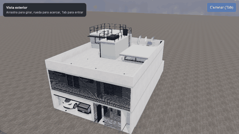

# playing-architect

[](https://luisfpal.github.io/playing-architect/)
[](LICENSE)
[](https://threejs.org)
[](https://rapier.rs)
[](https://www.blender.org)
[](https://ifcopenshell.org)
[](https://www.python.org)
[](viewer/)

A side project where I played architect with AI coding agents, to see how far they would get.



**[Walk the house in your browser](https://luisfpal.github.io/playing-architect/)**, on a computer or a phone. Two storeys
and a roof terrace, with collisions, stairs, a ladder to the roof, doors, drawers and windows that open, a room menu,
a minimap and touch controls.

## How it's built

- **The plan is code.** Rooms, walls, openings, stairs and furniture are described in Python and written to IFC with
  IfcOpenShell. Checks read the IFC back and measure it: room sizes, door clearances, stair rise and run, every room
  reachable. [pipeline/](pipeline/) runs the same steps on a small sample plan.
- **Blender, headless,** turns the IFC into the scene (materials, lights, furniture, appliances) and exports a GLB. Each
  node carries a few extras (what collides, what opens and around which hinge, where each room's spawn point is),
  documented in [docs/glb_contract.md](docs/glb_contract.md).
- **The viewer** is plain ES modules with no build step: three.js for rendering, Rapier for the character controller and
  colliders. Its modes (loading, orbit, walk, paused, error) are a statechart ([docs/statecharts.md](docs/statecharts.md)),
  and a test fails if the code and the diagram disagree.
- **The agents.** I ran them (Cursor, Claude Code, and DeepSeek for bulk edits) in review rounds. Each round
  ended the same way: rebuild, render fixed views of every room and look at the pictures, then walk the house for real
  in headless Chromium. Many bugs only showed up there: a washer door that opened onto a flat panel, or a bathroom you could walk into
  and not get out of.
  The instructions they followed are in [skills/](skills/).
- **Loading.** About 1 million triangles in a 38 MB GLB. Only lossless steps (meshopt, lossless WebP, pruned
  attributes), checked by rendering the same views before and after ([tools/web/](tools/web/)).

## Layout

```
viewer/      the walk-through viewer (main, physics, interact, nav, minimap, touch) and its Playwright tests
pipeline/    plan-as-code to IFC to GLB, on a small sample floor plan
tools/web/   GLB optimisation and before/after render comparison
docs/        GLB contract and viewer statecharts
skills/      the instructions the agents followed
site/        landing page
deploy/      static server (gzip + ETag) and a systemd unit
```

## Run it

```sh
make glb      # download the scene (38 MB release asset) to build/house.glb
make serve    # http://127.0.0.1:8080/
make test     # headless Chromium: movement at 30/60/120 fps, stairs, every room, doors, drawers, touch, ladder
```

Needs Python 3, [uv](https://docs.astral.sh/uv/) and, for `make optimize`, Node 20+. The tests are end to end under
software rendering, so they take minutes, not seconds.

## Limits

Not an engineered building: structure, plumbing and wiring are placeholders, and the checks cover geometry and
reachability only.

Code is MIT. Third-party models, textures and the sky keep their own licences (CC BY 4.0 and CC0), listed in
[CREDITS.md](CREDITS.md).
