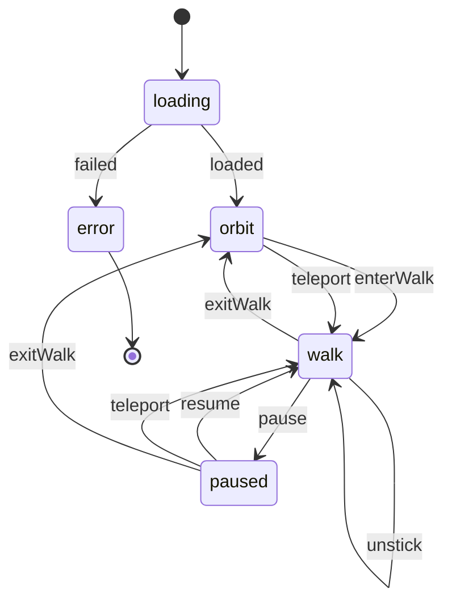
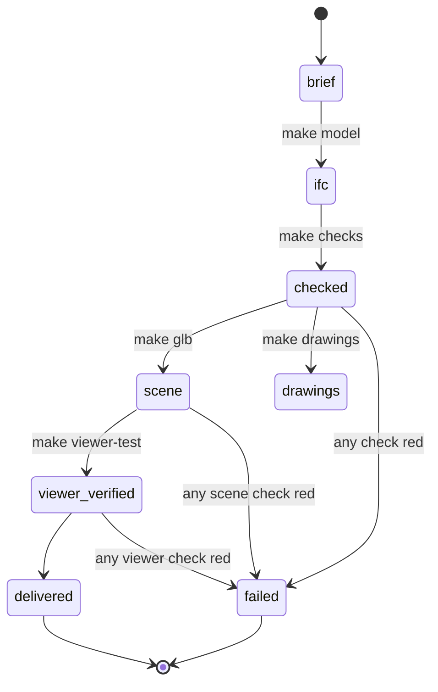

# Statecharts

Two machines. Both are enforced by a script, so the diagrams cannot drift from the code: `viewer/test_viewer.py` parses the viewer chart below and compares it with the `MACHINE` table in `viewer/machine.js`; `make all` runs the pipeline in the order of the second chart and fails at the first red stage.

Status 2026-10-24: chart 1 is implemented by `viewer/machine.js` (the only writer of the mode is `send()`), and `viewer/test_viewer.py` fails if the table and this chart differ.

## 1. Viewer modes

An event that is not drawn from the current state is ignored (`send` returns false). Nothing else changes the mode: no boolean flags such as `isWalking`. The help panel and the HUD are UI, not modes.

| State | Meaning | Camera and input | Physics |
|---|---|---|---|
| loading | `casa.glb` downloading and colliders building; progress bar | none | not created |
| orbit | outside view. Target is the house centre; distance is clamped to at least the house bounding radius + 2 m, polar angle at most 85 degrees, so the camera can never enter the house or go under the ground | OrbitControls (drag, wheel) | player capsule frozen |
| walk | first person. Capsule radius 0.30 m, height 1.70 m, eye 1.60 m above the feet | WASD move, Shift run, mouse look (pointer lock), wheel changes field of view only (35 to 75 degrees), never position | Rapier kinematic character controller, gravity, autostep 0.20 m, snap to ground 0.30 m, fixed 60 Hz step |
| paused | walk interrupted; menu with the room list, help and the two buttons "Seguir caminando" and "Ver desde afuera" | menu clicks | player frozen in place |
| error | load failed; message visible; terminal | none | none |

Events (the only ways in or out of a state):

| Event | Source |
|---|---|
| `loaded`, `failed` | GLB loader and collider build |
| `enterWalk` | Tab key or the "Caminar" button in orbit. The capsule spawns on the street in front of the gate, facing the house: the house is entered on foot, through the garage and the front door |
| `exitWalk` | Tab key in walk, "Ver desde afuera" in paused |
| `pause` | pointer lock released (Esc) or the M key |
| `resume` | click on the canvas or "Seguir caminando" |
| `teleport(room)` | a room in the menu: the capsule lands at that room's `spawn` (from the GLB extras, a point checked free of walls and furniture), facing the room's centre |
| `unstick` | the stuck detector (input held for 2 s with less than 1 cm of movement) or the R key: the capsule returns to the last grounded position that had 0.35 m of free radius; a fall below the lowest floor minus 1 m does the same |

## 2. Build pipeline

Each arrow is a Makefile dependency. A stage that fails stops the chain, so a later stage never runs on a stale or broken earlier artifact. Drawings are off the critical path in round 3 (plans are secondary) but still come from the same IFC.

| Stage | Proof that it worked |
|---|---|
| ifc | `build_house.py` writes `build/casa.ifc` |
| checked | `checks.py` reads the IFC back and measures the layout; `make prove` shows each mutant turns its check red |
| scene | `glb_check.py`: every furniture role replaced by an asset or a procedural model, no brown outside the wood whitelist, every node carries a `collider` tag, every space has a free `spawn`, triangle and size budgets |
| viewer_verified | `viewer/test_viewer.py` in headless Chromium with real key and mouse input: chart 1 equals `MACHINE`, wall blocking, stairs, entry on foot, orbit clamp, teleport to every room, screenshots |
| drawings | `check_drawings.py` re-reads every DXF |
